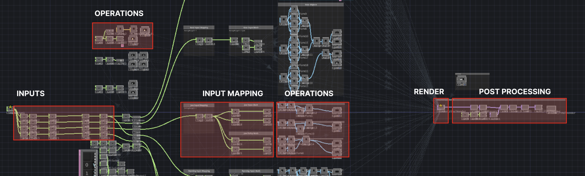
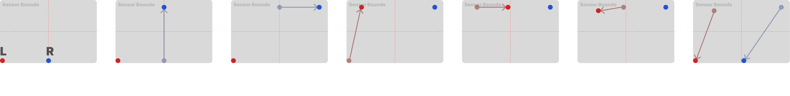

# P1---MUSC419

## OVERVIEW

This repository contains all the relevant files and content used in the design and developement of 'Horologue' for MUSC 419 - Project 1.

|PROJECT DETAIL|DESCRIPTION|
|----|----|
|PROJECT NAME|Horologue|
|CREATED BY|Johannes Soderstrom|
|COMPLETED FOR|MUSC 419|
|TYPOLOGY|Interactive Audio Work|
|DATE PRESENTED|21 October 2026|
|PROJECT TIME FRAME|~ 5 Weeks|

Files used in the process of creating the project are located in the 'dev' folder, which contains images, .blend files and other preliminary or process work.

## CONCEPT

The artistic concept of this work stemmed from a desire to combine 3D models and animations with interactive inputs on touchdesigner. Because of this, the creative concept revolves around the artists ability to manipulate a mechanical "clock" controlling an ambient soundscape. The work is anchored by a ticking sound and visual represented by the hand of the clock. Various elements on screen and in the audio of the project revolve around this concept.

The aim of this project was both to execute on this creative vision, as well as to learn and familiarize myself with touchdesigner, and utilizing 3D assets and animations in touch designer.

## TECHNICAL METHODOLOGY

The project is built around/organized with the following data pipeline:

Inputs -> Input mapping -> Operations -> Rendering -> Post Processing

- Inputs: Takes leapmotion data and selects the data to use for the project.
- Input mapping: Maps all the inputs and used variables to a usable range of 0-1 and clamps inputs for consistency.
- Operations: Applies values to geometry transformations, lighting variables, audio effects, compositing, etc...
- Rendering: Renders the 3D objects in the scene with camera setup and object placement.
- Post Processing: Applies various post processing effects on top of the initial render.

An example of how this looks in the project file is shown below:



**The addition of fbx models with imported animations seem to be extremely computationally expensive and will likely not be used in future projects.**

There are only 4 inputs being used, being the L and R hand x and y position, this allows for a more intuitive control and avoids complexity and potential performance errors.

These inputs are used to impact parameters on material geometries, animation states, post processing effects and object transformations.

### MAPPED INPUTS

For this section; x = horizontal (left/right), y = depth (forward/backwards), z = vertical(altitude)

|Control|Visual Change|Audio Change|
|--|--|--|
|Hand L - x|Pistons, Central opening, Bloom, Lens distortion|Global Reverb value, Chord progression volume|
|Hand L - y|Gear spin speed and lighting|Arpeggiator volume|
|Hand R - x|'Jaw' openness|Ambience volume|
|Hand R - y|Clock animation speed and lighting|Global audio speed and volume|
=

## PERFORMANCE CHECKLIST

### SETUP

1. Download the complete zip file from github [here](https://github.com/J-A-SOD/P1---MUSC419)
2. Extract the zip file and its contents
3. Plug in the leap motion sensor, orienting it with the green light facing the performer
4. Make sure your computers audio device is set to the correct option relevant to your performance needs or location
5. Open ```horologue.toe```
6. Place your hands above the leapmotion sensor (30cm up), in a closed fist, and confirm interaction is functional
7. Determine the range of motion is adequate for all mapped inputs

### PERFORMANCE

Using the mapped inputs, control the various audio,visual parameters and effects as creatively inclined/

The series of motions used in the initial performance are as follows:



## DISCLAIMERS & CREDITS


Include a **maximum two-page write-up** containing:

- **Concept** — a brief description of the artistic concept and approach.
- **Technical methodology** — an explanation of how the interactive system works, including the sensor data used and how it is mapped to the visual system.
- **Performance checklist** — a step-by-step procedure for setting up, testing, and running the work so that the performance can be reliably reproduced.
- **AI involvement** — if AI was used, describe how it was used and how it contributed to the project.